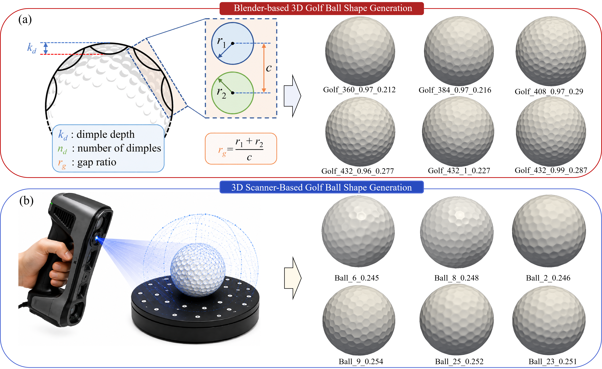
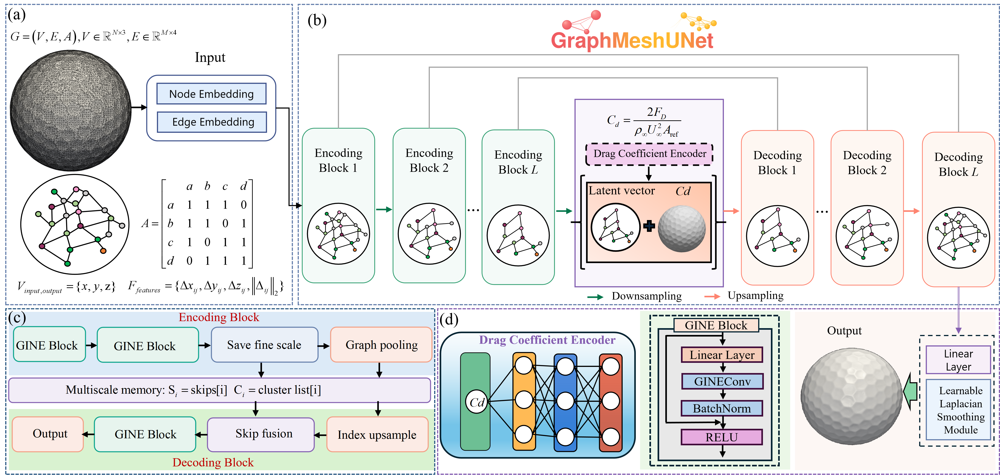
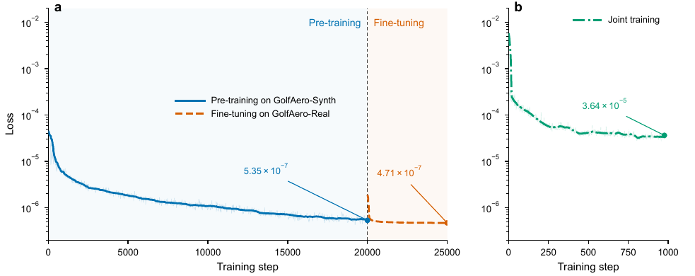

# GraphMeshUNet: A Physics-Guided Graph Autoencoder for High-Fidelity Three-Dimensional Golf Ball Shape Generation

GraphMeshUNet is a physics-guided graph autoencoder for high-fidelity 3D golf ball shape generation. This repository presents the datasets, model architecture, and experimental results.

## Installation

The training and testing files of the model are in H5 format, and the data loading method is:
```python
 with h5py.File(filePath, "r") as f:
            pts = f["pts"][:]
            edges = f["edges"][:]
            edges_features = f["edges_feature"][:]
```
In the "models" folder, you can obtain the GraphMeshUNet-related models and training code.

## Citation

## License
This project is licensed under the Apache License 2.0. See the [LICENSE](./LICENSE) file for details.
## Datasets

<p align="center">
  
</p>
<p align="center">
  <em>Figure 1. Overview of the GolfAero-Synth and GolfAero-Real datasets.</em>
</p>

## Model Architecture

<p align="center">
  
</p>
<p align="center">
  <em>Figure 2. Overall architecture of GraphMeshUNet for 3D golf ball shape generation.</em>
</p>

## Experimental Results

### Smoothing Configurations

<p align="center">
  
</p>
<p align="center">
  <em>Figure 3. Loss convergence under different smoothing configurations during the first 1,000 training steps.</em>
</p>

### Training Strategies

<p align="center">
  
</p>
<p align="center">
  <em>Figure 4. Comparison of loss convergence under different training strategies.</em>
</p>

### Comparison with Baseline Models

<p align="center">
  
</p>
<p align="center">
  <em>Figure 5. Qualitative comparison of generated golf ball geometries with the corresponding ground truth: (a) PointNet Diffusion, (b) PointNet, (c) VAE, and (d) GIN.</em>
</p>

### GraphMeshUNet Generation Results

<p align="center">
  
</p>
<p align="center">
  <em>Figure 6. GraphMeshUNet generation results on the two test sets: (a) GolfAero-Synth and (b) GolfAero-Real, covering different commercial golf balls.</em>
</p>

## Interactive 3D Visualization

Click the preview below to open the interactive 3D viewer.
Drag to rotate and scroll or pinch to zoom.

[](https://zuokuijun.github.io/graphMeshUNet/)

[Open interactive viewer](https://zuokuijun.github.io/graphMeshUNet/) · [Download STL](./docs/assets/golf_ball.stl)
